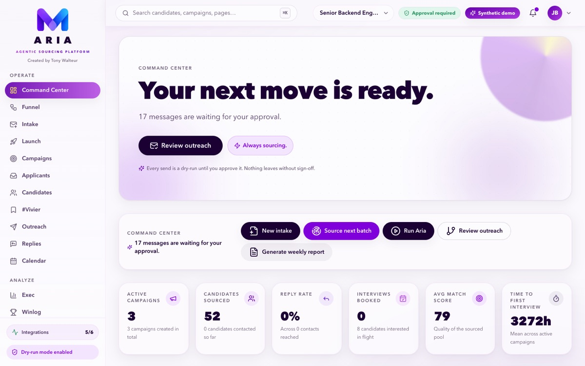
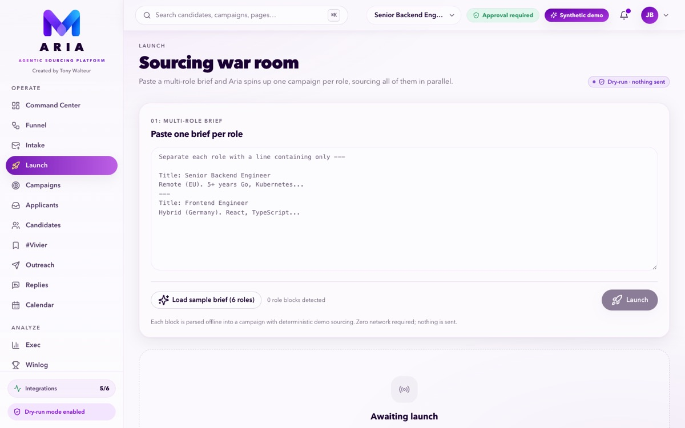
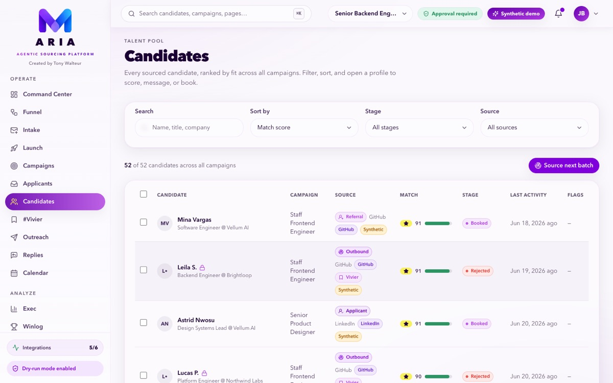
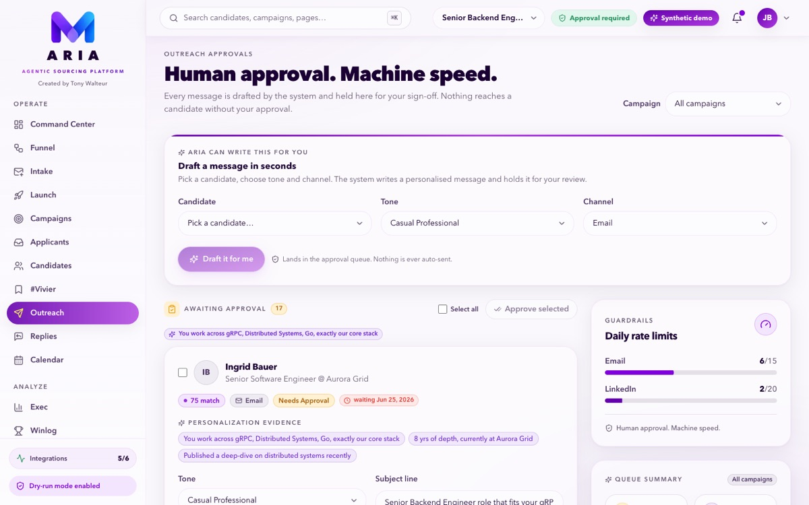
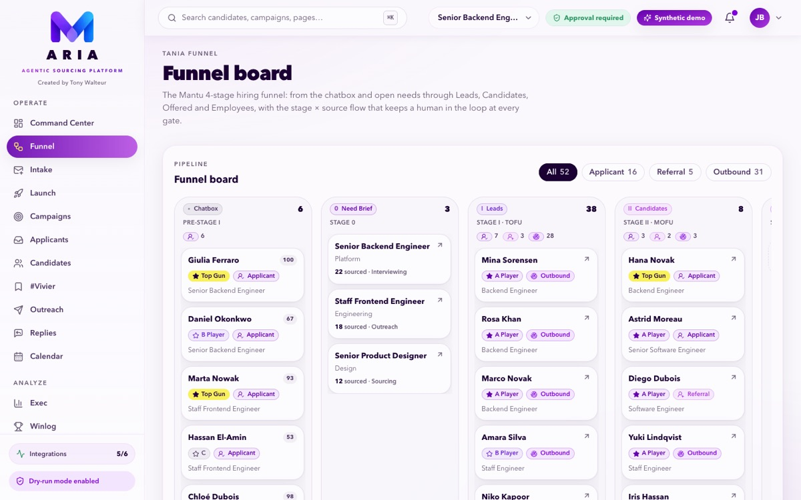
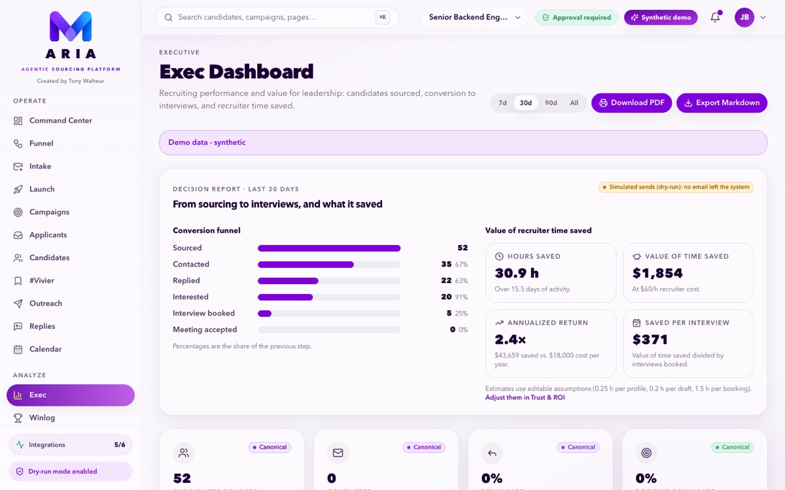

# ARIA (MSourcing)

ARIA is a recruiting console. Give it a hiring need and it sources candidates,
drafts outreach that a recruiter approves, tracks replies and interviews, and
reports the results to leadership.



## What it does

1. **Brief.** Paste a job description (or several) on **Launch** or **Intake**. ARIA turns
   each role into a campaign.
2. **Source.** The sourcing agent searches GitHub, the web (LinkedIn, Stack Overflow,
   Dribbble, Behance via Tavily) and Apify LinkedIn search. It scores and dedupes the
   candidates it finds.
3. **Review candidates.** Every candidate has an explainable match score. The talent pool
   (**Vivier**) keeps them across campaigns.
4. **Reach out.** ARIA drafts a personal message per candidate. Nothing is sent until a
   human approves the exact text.
5. **Follow up.** Replies are classified, and interviews are booked on the **Calendar**.
6. **Report.** **Exec** shows the conversion funnel, recruiter time saved and the return on
   cost for a chosen period. You can export it as PDF or Markdown.

A public **Careers** page feeds applications into the **Applicants** inbox.

| Launch a batch of roles | Ranked candidates |
|---|---|
|  |  |
| **Human approval before any send** | **Funnel board** |
|  |  |

### Decision-maker report



The time-saved figures come from editable assumptions (hourly cost, minutes per profile,
draft and booking, monthly tool cost) set in **Trust & ROI**. In demo mode, sends are
simulated (dry-run) and the report says so.

## Try it

### Quick look: synthetic demo, no Docker

```bash
npm install
npm run dev
```

Open <http://localhost:3000>. With no Supabase settings, the app runs on synthetic demo
data in the browser. Nothing is stored and nothing is sent.

### Full local stack with Docker

You need Docker Desktop with about 4 GB of memory.

```bash
# Needed to store API keys from Settings (encrypted at rest):
echo "DATA_ENCRYPTION_KEY=$(openssl rand -base64 32)" >> .env.local

docker compose up --build
```

Open <http://localhost:3000> and sign in as `admin@hermes.local` / `admindemo123`. The
first build takes a few minutes. [`DOCKER.md`](DOCKER.md) covers ports, resets and
troubleshooting.

### Connect the real integrations

The stack runs without any external key. Each integration turns on once its key is set.

| Capability | How to enable |
|---|---|
| GitHub sourcing | Works without a key (60 requests/hour). `GITHUB_TOKEN` in `.env.local` raises it to 5,000/hour. |
| Web sourcing | Tavily key in **Settings → API keys**. |
| Apify LinkedIn search and enrichment | Apify token in **Settings → API keys**. |
| AI sourcing agent and drafting | Anthropic or OpenAI-compatible key in **Settings → API keys**, enabled under **Settings → LLM providers**. Without one, the agent runs in rule-based mode. |
| Sending email and syncing replies | Connect a Gmail or Outlook mailbox under **Mailboxes** ([guide](docs/runbooks/connect-gmail-outlook.md)). |
| Dust agents, MCP tools | **Settings → Dust agents** and **Settings → Tools**. |

[`.env.local.example`](.env.local.example) lists every variable.

## Ground rules

- No message reaches a candidate without a recorded human approval of its exact text.
- LinkedIn is never automated: no login automation, no scraping, no rate-limit bypass.
- Provider keys stay on the server and are encrypted at rest.

## For developers

| Area | Technology |
|---|---|
| App | Next.js 16, React 19, TypeScript, Tailwind |
| Data and auth | Self-hosted Supabase (Postgres with row-level security, GoTrue, PostgREST, Kong) |
| AI | Server-side calls to Anthropic or OpenAI-compatible APIs |
| Runtime | Docker Compose locally. An internal Azure deployment (Terraform) is planned. |

To work on the app with hot reload against the Docker backend, run
`docker compose stop app`. Then put `NEXT_PUBLIC_SUPABASE_URL=http://localhost:54321` and
the keys from `docker-compose.yml` in `.env.local` and run `npm run dev`.

Every change must keep this gate green:

```bash
npm run typecheck && npm run typecheck:tests && npm test && npm run lint
```

More documentation:

- [`docs/ARCHITECTURE.md`](docs/ARCHITECTURE.md): code layout, data model, sourcing agent, outreach
- [`docs/SOURCING.md`](docs/SOURCING.md): sourcing, scoring, enrichment, compliance
- [`docs/TESTING.md`](docs/TESTING.md): test suites
- [`SECURITY.md`](SECURITY.md) and [`CONTRIBUTING.md`](CONTRIBUTING.md)

The product is called ARIA; the repository is MSourcing. Some code identifiers still say
`hermes` for compatibility.
