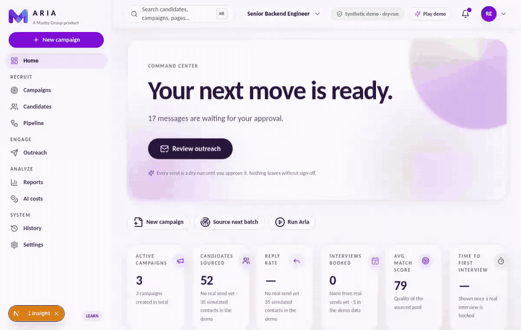
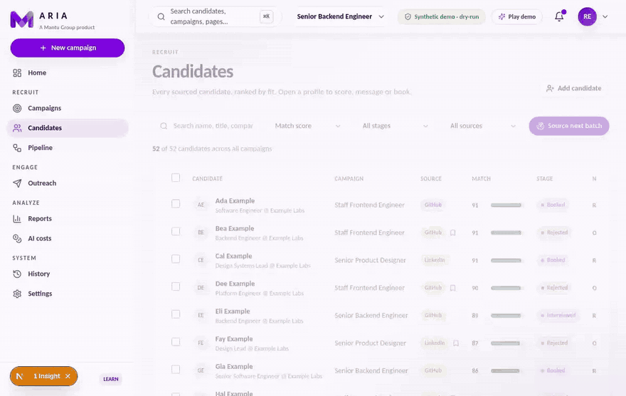
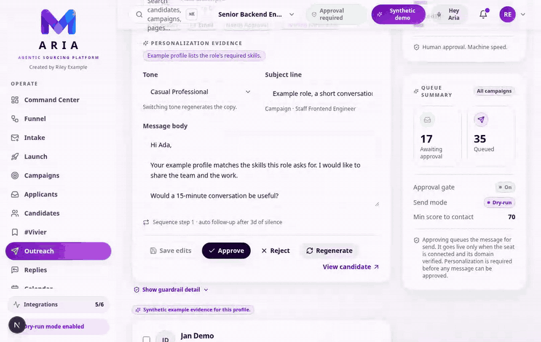
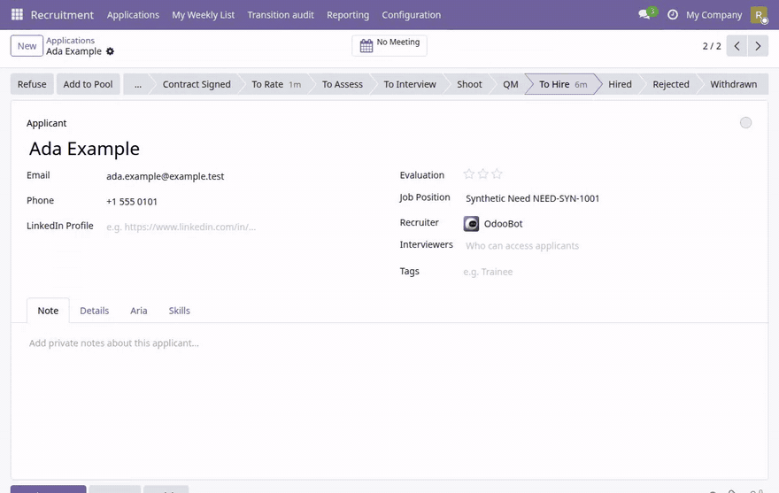
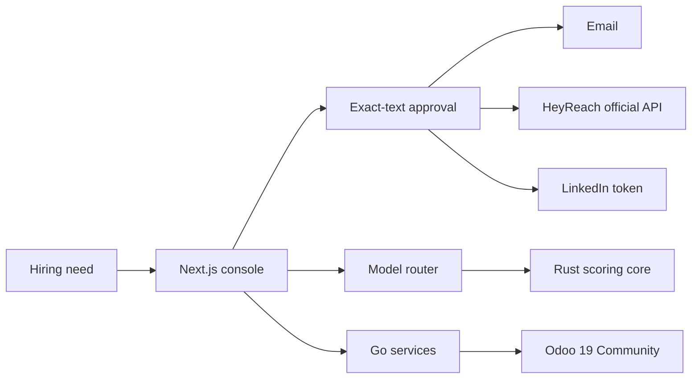
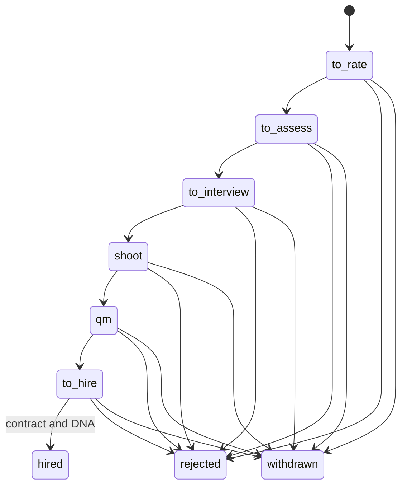

# Aria

Aria is an AI sourcing and outreach agent. A hiring need goes in. Ranked candidates come out, each with a reason, plus a draft that a person approves before anything is sent.

The console on this branch is the recruiting product built by Michael Bernard. Tony Walteur's Command Center quick-stat design is the interface direction for the same flow. It is linked under [Project status](#project-status) because it is not merged yet.

`twa-odoo` today runs the Next.js console and a local Docker demo. Odoo 19 Community is the system of record in review, not in this branch. The same is true of the Rust scoring core, the Go services, the model router, and the outreach channel adapters.

## See it

The loops use synthetic people only. Names such as Ada Example are fixtures. Nothing in them is a real profile, and nothing was sent.

### Command Center

Today's home page. The quick stats sit under the next action: campaigns, people sourced, reply rate, interviews, average match, and time to a first interview. Sends in this demo are dry-run.



Tony's original quick-stat layout is in review in [pull request 177](https://github.com/mysticalsin/aria-sourcing/pull/177). The loop above is the Command Center that `twa-odoo` serves now.

### Ranked candidates, with reasons

Open a person and the score is a breakdown, not a single unexplained number. The next step still says that approval of the exact message is required.



### Approve the exact text

The queue holds the draft. Approving records that text. In the synthetic demo the send mode is dry-run, so the approval queues nothing to a real mailbox.



### The Hired gate refuses a missing contract

Odoo 19 keeps the pipeline. Moving Ada Example from To Hire to Hired, with no contract and no completed DNA check, is refused on the server. The applicant stays in To Hire.

This loop is the addon in [pull request 176](https://github.com/mysticalsin/aria-sourcing/pull/176). It is not part of the `twa-odoo` image.



## Quick start

Docker Engine 25 or newer, with Compose. The first build compiles the app and migrates the local database.

```bash
docker compose up --build --detach --wait --wait-timeout 300
```

Open <http://localhost:3000/login>. The local sample sign-in is `admin@aria.local` / `admindemo123`. Those credentials are for this loopback demo only. Ports, resets, and the service list are in [DOCKER.md](DOCKER.md).

The console loops above come from the synthetic browser demo, which loads when Supabase is unset. The Docker stack is live mode and starts without that seed. Do not run a live source from the Docker demo if you need fixture people only: live search can reach public networks.

```bash
npm install
npm run dev
```

Then open <http://localhost:3000>. To record the loops again, use [scripts/record-readme-gifs.mjs](scripts/record-readme-gifs.mjs).

## How it works

A recruiter pastes a hiring need. Aria turns it into a campaign, ranks candidates it can explain, and drafts outreach. A person approves the exact text. Delivery stays inside caps, a kill switch, and an audit trail once those controls are merged. Odoo 19 Community is the system of record for the pipeline, including the hire.

On `twa-odoo` the boxes you can run are the Next.js console, exact-text approval in the demo, and the local Docker stack (the app, Postgres, GoTrue, PostgREST, and Caddy). The other boxes are the open pull requests in [Project status](#project-status).



HeyReach and the LinkedIn token stay off until someone turns them on. There is no LinkedIn scraping and no LinkedIn automation in that design.

### Pipeline stages

The Odoo addon owns nine stages. Hired is not a button that always works. The only way in is from To Hire, and only when a contract is attached and the DNA check is `integrated` or `complete`. A CV does not count as the contract. `hired`, `rejected`, and `withdrawn` are terminal.



One step back along the pipeline is allowed until a terminal stage. The stage list is `to_rate`, `to_assess`, `to_interview`, `shoot`, `qm`, `to_hire`, `hired`, `rejected`, and `withdrawn`.

## Safety and compliance

- Default outreach is manual. A person approves the exact text. The synthetic demo keeps send mode on dry-run.
- Opt-in automatic send, after a QC gate, with caps, a kill switch, and an audit trail, is in review in [pull request 167](https://github.com/mysticalsin/aria-sourcing/pull/167). It is not the default on this branch.
- Hired is a server-side gate. It needs a contract plus a DNA status of `integrated` or `complete`. That gate lives in [pull request 176](https://github.com/mysticalsin/aria-sourcing/pull/176), with the Go adapter and fake DNA check in [pull request 171](https://github.com/mysticalsin/aria-sourcing/pull/171).
- Email is the channel the console drafts today. HeyReach uses the official API and ships with the flag off ([pull request 175](https://github.com/mysticalsin/aria-sourcing/pull/175)). The LinkedIn token channel is off by default ([pull request 178](https://github.com/mysticalsin/aria-sourcing/pull/178)).
- No LinkedIn scraping. The token channel is not a scraper.
- This branch still contains an older LinkedIn bridge and a campaign autopilot. Removing them, and removing web-search sourcing, is in review in [pull request 168](https://github.com/mysticalsin/aria-sourcing/pull/168). Do not treat that bridge as the supported channel.

Provider keys stay on the server. The local Docker demo binds to loopback. [SECURITY.md](SECURITY.md) is the security note for this repository.

## Testing

The project gate is:

```bash
npm run typecheck && npm run typecheck:tests && npm test
```

`npm test` includes the README check in `tests/readme-docs.mts`. It fails unless every relative link resolves to a file in this repo, the README embeds three or four GIF loops under `docs/media/`, each loop is under 3 MB and at most 8 seconds, and the markdown lint in that file passes.

CI also lints, builds, audits dependencies, scans for secrets, runs the database suites, and boots the local Docker demo. The layers are listed in [docs/TESTING.md](docs/TESTING.md).

## Project status

Checked against open pull requests into `twa-odoo` on 21 November 2026. "In review" means the pull request is open. It is not on this branch.

| Piece | On `twa-odoo` today | In review |
| --- | --- | --- |
| Next.js console, synthetic demo, local Docker stack | Yes | |
| Exact-text approval, dry-run by default in the demo | Yes | |
| Command Center quick-stat design | Today's home page, shown above | [177](https://github.com/mysticalsin/aria-sourcing/pull/177) |
| Rust scoring core | No | [170](https://github.com/mysticalsin/aria-sourcing/pull/170) |
| Go services, Odoo adapter, DNA check | No | [171](https://github.com/mysticalsin/aria-sourcing/pull/171) |
| Model router | No | [169](https://github.com/mysticalsin/aria-sourcing/pull/169) |
| Odoo 19 pipeline and Hired gate | No | [176](https://github.com/mysticalsin/aria-sourcing/pull/176) |
| Email and HeyReach adapters, HeyReach flag off | No | [175](https://github.com/mysticalsin/aria-sourcing/pull/175) |
| LinkedIn token channel, off by default | No | [178](https://github.com/mysticalsin/aria-sourcing/pull/178) |
| Auto-send QC gate, caps, kill switch, audit | No | [167](https://github.com/mysticalsin/aria-sourcing/pull/167) |
| Remove the LinkedIn bridge and autopilot | Bridge still in this branch | [168](https://github.com/mysticalsin/aria-sourcing/pull/168) |

Other open work on the same base includes a console split ([172](https://github.com/mysticalsin/aria-sourcing/pull/172)), a design-system gallery ([173](https://github.com/mysticalsin/aria-sourcing/pull/173)), and CV ingest ([174](https://github.com/mysticalsin/aria-sourcing/pull/174)).

Code maps for what is actually merged: [docs/ARCHITECTURE.md](docs/ARCHITECTURE.md) and [docs/SOURCING.md](docs/SOURCING.md).

## Credits

Michael Bernard built the ARIA recruiting console this repository continues.

Tony Walteur's original quick-stat Command Center is the design being ported onto Aria's processing flow.

Regenerate the loops with [scripts/record-readme-gifs.mjs](scripts/record-readme-gifs.mjs).
