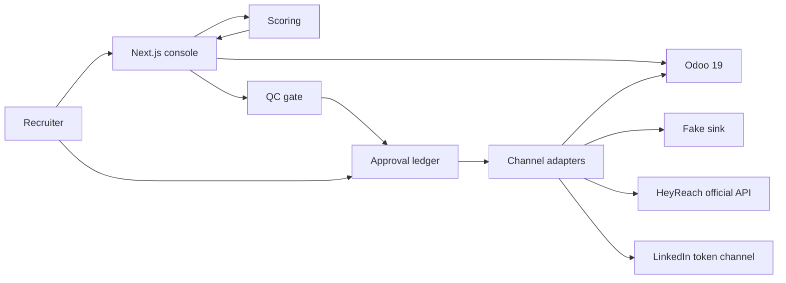

# Aria architecture

Aria turns a hiring need into a ranked, explainable list of candidates and into outreach drafts. A person approves the exact text before anything is sent. Odoo 19 Community is the system of record for stages. Hired is a server-side gate: the move is accepted only when a contract is attached and DNA reports the contract integrated.

This page describes the pieces that exist on `twa-odoo` and the pieces that exist only on open pull requests. Anything that is only on an open pull request is marked **in review**. Pull request numbers are the public review records. This page does not describe a merged production deploy.

## Status vocabulary

| Mark | Meaning |
| --- | --- |
| on `twa-odoo` | Present on the branch this design set is written against |
| in review | Present only on an open pull request. The base branch does not contain it |

The open pull requests were read at the heads listed in the component table. A later push can move a head. The integration branch (#208) combines several of those heads so they can be exercised together. It is a test vehicle and stays unmerged.

## Components

| Component | Responsibility | Status |
| --- | --- | --- |
| Next.js console | Campaigns, candidates, outreach queue, reports, and settings. Live mode uses the signed-in role and the workspace database. Demo mode uses a synthetic workspace. | on `twa-odoo`. A feature-module split of the same console is in review (#172). Quick-stat cards for the processing flow are in review (#177). A standalone design gallery at `/design-system` is in review (#173) and is not imported by the console pages. |
| TypeScript scoring | The ranker the console uses today. A sourcing run in live mode requires a reviewed brief and at least one reviewed query. | on `twa-odoo` |
| Rust scoring core | Deterministic score, 90-day profile dedupe, exact-approval hash, and a stage machine. Go calls it in-process through a C ABI. Ranking is a suggestion. A score cannot select `rejected` or `withdrawn`. | in review (#170). Resolving the workspace with the committed lockfile is in review on top of that branch (#206). |
| Go services | Odoo client, in-memory fake, hire gate, and an HTTP API. The process serves the fake and refuses live mode. It does not dial Odoo or DNA. | in review (#171) |
| Odoo 19 addon `aria_recruitment` | Stage rows, the state machine, and the Hired gate inside Odoo. The shared stage spec is `spec/pipeline_stages.json` on that branch. Audit rows are append-only. | in review (#176) |
| Model router | Content-addressed cache, then deterministic rules, then a small model, then a big model when confidence is low or the task is a shortlisted draft. Providers in this module are fakes. API key values are not stored or logged. | in review (#169) |
| Approval ledger | Binds a send decision to the exact message. Manual approval is the default. Automatic mode is opt-in and still requires a quality-check pass on that same text. | in review (#167). Cap ownership on top of that branch is in review (#182). |
| QC gate | Pure checks over a draft and the facts it may use. It does not send and it does not import the ledger. | in review (#185). The ledger branch still uses a separate stub checker. |
| Channel adapters | Email through an injected mail port, and HeyReach through its official API. | in review (#175) |
| LinkedIn token channel | Optional session-token send. Off until an owner or admin records the risk notice. The token is encrypted, revocable, and scrubbed from logs. | in review (#178) |
| Compliance removal | Removes the browser bridge, the campaign autopilot, and web-search sourcing from the tree those features still occupy on `twa-odoo`. | in review (#168) |
| CV ingest | Text layer, local OCR when the text layer is too thin, parse, duplicate hook, then `to_rate`. Failures sit on an error queue. | in review (#174) |
| Fairness audit | Offline report for one ranking run. A protected-group label is counted only when it is self-declared and consented, and it is never passed to the scorer. The report does not drop a candidate. | in review (#180) |
| Interviewer hand-off | Posts a screening request once the stage is `to_interview`, a human approval is on record, and consent is true. The recommendation is advisory and does not change a stage. | in review (#184). `ARIA_INTERVIEWER_ENABLED` defaults off. |
| Request-boundary hardening | Tightens how the console derives the caller address, which model endpoint it will use, how the compose secret is supplied, and which browser origins the gateway accepts. | in review (#201) |

## Data flow

1. A recruiter records a hiring need. On `twa-odoo` that need is a campaign in the console. In review, the same need is also an Odoo job.
2. Sourcing and CV ingest produce candidates. The ranker attaches a score and reasons. The score is a suggestion for the recruiter.
3. The recruiter reviews the list and moves the stage in Odoo. Hired is decided inside Odoo, not in the browser.
4. Outreach is drafted in the console. The QC gate scores that exact draft. The approval ledger records a human approval, or an opt-in automatic authorization after a passing QC result bound to the same text.
5. A channel adapter delivers only after that authorization. Tests use a fake sink. HeyReach and the LinkedIn token channel stay off until their flags are set. Every attempt writes an Odoo audit note before the transport runs.

## Trust boundaries

Boundaries are described by role. Host names that belong to one installation are not part of this design.

**Browser.** The console shows drafts, scores, and stage labels. It can record a human choice. It is not the authority for a credential, for an approval hash, or for the Hired move.

**Console server.** On `twa-odoo` this is the Next.js process. Live mutations go through the signed-in role and the workspace database. Demo mode blocks production side effects. Provider credentials stay on the server.

**Scoring.** On `twa-odoo` the TypeScript ranker runs in the app process. In review, Go calls the Rust core in-process. Either ranker returns an ordered list with reasons. Neither one sends mail, and neither one is allowed to choose `rejected` or `withdrawn` from a score.

**System of record.** In review, Odoo 19 Community holds the stage. The Hired write is refused in `create`, `write` (including elevated and RPC writes), import, and stage recomputation unless both guards pass: an attachment whose document kind is `contract`, and a DNA status of `integrated` or `complete`. A CV does not satisfy the contract guard. An unknown DNA adapter name fails closed. The built-in DNA adapter is an in-process fake and does not open a connection. The Go service in review enforces the same pair of guards against its fake and refuses live mode.

**Model router.** In review, the router answers from cache, rules, or a fake provider. It does not open a network connection. Budget ceilings are reserved before a provider call. A budget refusal is not cached.

**Approval and delivery.** A send is authorized for one exact text. Changing a byte, the recipient, the channel, or the notice requires a new authorization. Channel adapters verify the authorization. They do not mint it. An audit note is written before the transport. If that note fails, nothing is sent.

**Channels.** The fake sink stays on the test harness. HeyReach accepts only the vendor's official API host and only when `ARIA_HEYREACH_ENABLED` is on. The LinkedIn token channel stores ciphertext, scrubs the token from logs, and can revoke it. There is no LinkedIn scraping and no login automation in the in-review channel design. The older browser bridge is still on `twa-odoo`; its removal is in review (#168).

**Interviewer.** In review, the adapter calls out only when its flag is on, the stage is `to_interview`, approval is recorded, and consent is true. The returned recommendation does not move a stage and does not reject a candidate.

**Fairness.** In review, the audit reads a finished ranking. Consented group labels are not inputs to the scorer. The tool has no auto-reject path.

## Stage keys

The nine keys, in pipeline order, then the two terminal exits:

`to_rate`, `to_assess`, `to_interview`, `shoot`, `qm`, `to_hire`, `hired`, `rejected`, `withdrawn`

Display labels such as "To Rate" are not accepted as transition input. `hired`, `rejected`, and `withdrawn` are terminal.

Two in-review copies of the machine disagree, and both are still open:

| Copy | Where | Moves |
| --- | --- | --- |
| Odoo spec | #176, `spec/pipeline_stages.json` | One step forward, one step back between adjacent non-terminal stages, plus `rejected` and `withdrawn`. `hired` only from `to_hire`, and only with the contract and DNA guard. |
| Rust core and Go stage package | #170 and #171 | One step forward, plus `rejected` and `withdrawn` with a non-empty reason. No step back. Rust stays in `to_hire` when the hire guard fails. |

A later change is expected to load one spec in Rust, Go, and Odoo. Until that lands, the Odoo addon is the enforcement point for a real stage write, and the Rust and Go copies are the in-process checks on their own branches.

## What `twa-odoo` runs today

The checked-in application is the Next.js console, TypeScript scoring, email outreach with a human approval path, and a local Docker demo. The map of that tree is [the current architecture guide](../ARCHITECTURE.md).

That tree still contains the browser-bridge LinkedIn path and the campaign autopilot. The in-review compliance change removes them. Design pages in this folder describe the target those pull requests are building. They do not claim the base branch already behaves that way.

## Related pages

- [Pipeline](PIPELINE.md)
- [Outreach safety](OUTREACH-SAFETY.md)
- [Testing](TESTING.md)
- [Roadmap](ROADMAP.md)
- [Documentation map](../README.md)
