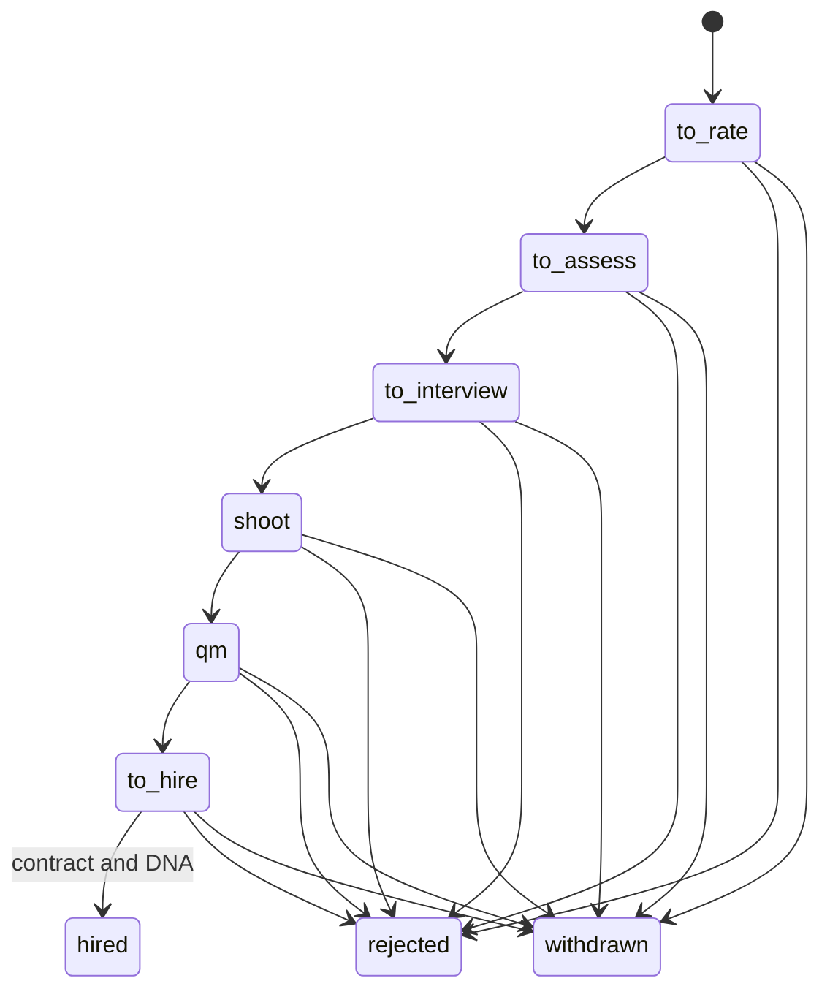

# Aria pipeline

Each step has a gate. A later step does not weaken an earlier one. Status marks match [the architecture page](ARCHITECTURE.md): **on `twa-odoo`** or **in review**.

The diagram is the forward contract shared by the in-review Odoo spec, the Rust core, and the Go stage package. The Odoo spec also allows one step back between adjacent non-terminal stages. The Rust and Go copies do not. `hired` stays gated on every copy. A score is not an edge.

## Brief

The recruiter states the role: title, must-have facts, location, and the queries or files used to look for people.

| Gate | Rule | Status |
| --- | --- | --- |
| Reviewed brief | A live sourcing run starts only from a reviewed brief and at least one reviewed query. | on `twa-odoo` |
| Need record | The need is an Odoo job. Stage keys are the nine machine keys. Display labels are not input. | in review (#176, #171) |
| Offer filters | Language, field, experience, location, contract type, and priority live on the job as structured fields. | in review (#176) |

## Source

Candidates enter from a reviewed source, from a file the recruiter uploads, or from a profile path a person already holds. Aria does not scrape LinkedIn and does not automate a LinkedIn login.

| Gate | Rule | Status |
| --- | --- | --- |
| Reviewed source | The console sourcing path runs the reviewed queries and records the run. | on `twa-odoo` |
| No bridge, no web-search sourcing | The browser bridge, the autopilot, and web-search sourcing are removed. A profile path already in hand can be stored. It is not fetched. | in review (#168). Those paths are still on `twa-odoo`. |
| CV file | Empty files, files over 8 MiB, encrypted files, and unreadable streams stop. A PDF with a text layer is read directly. A thin text layer or an image goes through local OCR. The duplicate hook runs before `to_rate`. | in review (#174) |
| Error queue | A failed ingest keeps an id, a reason code, an attempt count, and source slugs. The file and the parsed text are not stored on the queue row. Retry is capped. | in review (#174) |
| First stage | A successful ingest lands on `to_rate`. | in review (#174) |

The recorded click journey for "import a candidate" did not finish in the Next.js shell. CV ingest on that branch is a worker, and the console dialog did not confirm the add. See [Testing](TESTING.md).

## Rank

The ranker orders people and attaches reasons. The recruiter uses that order to decide who to open first.

| Gate | Rule | Status |
| --- | --- | --- |
| Suggestion only | A score, including zero, stays in the ranked list. The stage machine has no score parameter. | in review (#170). TypeScript scoring on `twa-odoo` is the ranker the console calls today. |
| Dedupe | Profile identity resolves inside a 90-day window, including transitive strong keys. | in review (#170) |
| Explanations | A ranked person has at least one top reason before a fairness report will pass. | in review (#180) |
| Group labels | A protected-group label is used only in the offline fairness report, and only when it is self-declared and consented. It is not passed to the scorer. | in review (#180) |
| Model spend | Drafts and extraction go through the router: cache, then rules, then a small model, then a big model. Hard token and spend ceilings are reserved before a provider call. | in review (#169). Providers in that module are fakes. |

The recorded click journey for "ranking with reasons" had no imported person to open.

## Review

A person reads the score, the reasons, and the stage, and moves the candidate.

| Gate | Rule | Status |
| --- | --- | --- |
| Human stage move | The recruiter advances, rejects, or withdraws. Reject and withdraw require a non-empty reason on the Rust machine. | in review (#170) |
| One step | Forward moves follow the diagram. The Odoo spec also allows a single step back before a terminal stage. Skipping ahead is refused on every in-review copy. | in review (#170, #171, #176) |
| Hired | Only from `to_hire`, and only with a contract attachment and a DNA status of `integrated` or `complete`. Otherwise the candidate remains in `to_hire`. | in review (#176 in Odoo, #170 and #171 in-process) |
| Terminal | `hired`, `rejected`, and `withdrawn` have no outgoing edge. | in review |
| Interviewer | A hand-off can be requested only in `to_interview`, with a recorded human approval and consent. The flag defaults off. The recommendation does not change the stage. | in review (#184) |
| Interview report | Finishing an interview activity without a report schedules an overdue report activity. | in review (#176) |

The Next.js shell has no Odoo screen. The Hired gate was exercised in the stress harness, not by a click. See [Testing](TESTING.md).

## Approve

Approval binds one exact text: channel, recipient, subject, body, and notice version.

| Gate | Rule | Status |
| --- | --- | --- |
| Exact text | The human approves the bytes that will be sent, one message or a batch. A later edit needs a new approval. | in review (#167). The console on `twa-odoo` already keeps human approval in front of email delivery. |
| Hash | The database row stores the wire hash and an exact-body hash that includes the approver, the time, the channel, the recipient, the subject, the body, and the notice version. | in review (#167) |
| Rust hash | A separate length-prefixed SHA-256 of channel, recipient, subject, body, and notice version. The body is not trimmed. | in review (#170). This hash and the TypeScript exact-body hash are not yet one encoding. |
| Lifecycle | `draft`, then `pending`, then `approved`, then `sent`. Any of those may become `invalidated`. Other edges are refused. | in review (#167) |
| Ledger mode | The in-memory ledger accepts demo and test runs. Live mode is refused there. The database approval row is the gate the send path checks. | in review (#167) |

The recorded click journey left the Approve control disabled, so the click never landed.

## Send

Delivery runs only after the approval gate. The channel rules are in [Outreach safety](OUTREACH-SAFETY.md).

| Gate | Rule | Status |
| --- | --- | --- |
| Order | Kill switch, channel flag, recipient allowlist, sender allowlist, approval binding, mode, caps and pacing, pause state, then the audit note, then the transport. | in review (#175 for the Go adapters, #167 for the ledger decision) |
| Fake sink | Tests deliver to an in-memory mail port or a loopback handler. A provider is not called. | in review (#175, #208) |
| HeyReach | Official API only, and only when the flag is on. | in review (#175) |
| LinkedIn token | Off until an owner or admin records the risk notice. | in review (#178) |
| Audit before send | If the Odoo note fails, the transport does not run. | in review (#175) |

The recorded click journey made zero sink calls. The stress harness did reach the sink. See [Testing](TESTING.md).

## Follow-up

A follow-up is a new draft. It does not reuse the previous approval.

| Gate | Rule | Status |
| --- | --- | --- |
| New text | The console can draft a follow-up. Sending it requires its own exact-text approval. | Draft controls are on `twa-odoo`. The hash binding is in review (#167). |
| QC invalidation | Editing a draft that had passed QC returns it to draft. A pass is not reused. | in review (#185) |
| Replay | The same approval token delivers once. An edited body is refused. An expired token is refused. | in review (#175, stress case A4 on #208) |
| After Hired | A hire does not by itself create a follow-up. The in-memory Go service can still store an outreach touch after Hired. That gap is open. | in review (#171, stress case A5 on #208) |

## Report

Reports explain the pipeline. They do not move a stage and they do not drop a candidate.

| Gate | Rule | Status |
| --- | --- | --- |
| Quick stats | Six counts: candidates to rate, in assessment, interviews this week, outreach awaiting approval, replies, and hires. | in review (#177). The labels rendered in the click run. The numbers were not compared with the rows, because a first-run modal covered them. |
| Weekly interview list | Interview activities, grades, a stale filter, and an exportable list. | in review (#176) |
| Fairness | Offline JSON and markdown for one ranking. Verdicts are Insufficient, Pass, Warn, and Fail. A group smaller than the minimum (default 30) gets no disparity verdict. `autoReject` is false. A Pass is not a legal certification. | in review (#180) |
| Transition audit | Every Hired attempt, allowed or refused, writes an append-only audit row and a chatter note. | in review (#176) |
| Erasure and opt-out | Erasure and opt-out live on the Odoo addon. The Next.js shell in the click run did not expose those controls. | in review (#176) |
