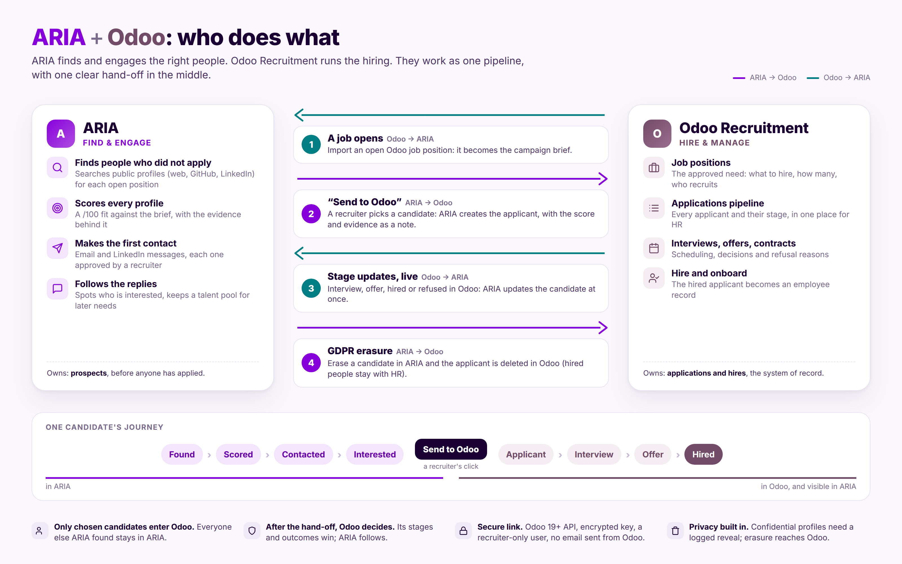

# ARIA and Odoo

How ARIA works with the group's Odoo, and how to connect it. The decision and
the options that were rejected are in
[`adr/0003-odoo-recruitment-system-of-record.md`](adr/0003-odoo-recruitment-system-of-record.md).



(Source: `images/aria-odoo-overview.html`, rendered at 1600x1000, 2x.)

## Where ARIA sits

Odoo Recruitment is the system of record for hiring: job positions,
applications, interviews, offers, hires, then employees. ARIA works in front
of it, on the part Odoo does not do: finding people who have not applied,
scoring them against the brief, and the first conversations (email, LinkedIn).

```text
            Odoo Recruitment                              ARIA
  ┌──────────────────────────────┐          ┌──────────────────────────────┐
  │ Job position (hr.job)        │──(1)────>│ Campaign (brief, sourcing)   │
  │                              │          │ Prospects: score, evidence,  │
  │                              │          │ outreach, replies            │
  │ Applicant (hr.applicant)     │<──(2)────│ "Send to Odoo" (recruiter)   │
  │ stages, interviews, offer,   │──(3)────>│ Candidate stage follows      │
  │ hired / refused              │          │                              │
  │                              │<──(4)────│ GDPR erasure                 │
  │ Employee (hr.employee)       │          │                              │
  └──────────────────────────────┘          └──────────────────────────────┘
  (1) import an open job as a campaign brief; the campaign stays linked to it
  (2) hand-off: one applicant + one internal note, on a recruiter's click
  (3) Odoo's stage and outcome come back to ARIA: pushed by Odoo the moment
      it changes (live updates), and read again when a campaign is opened
  (4) erasing the candidate in ARIA deletes the applicant ARIA created
      (unless hired)
```

ARIA calls Odoo's API. Odoo calls ARIA only for live updates, and only to say
"applicant N changed": ARIA then reads that applicant back with its own key.
Only people a recruiter decides to pursue enter Odoo. Everyone else ARIA found
stays in ARIA.

## Requirements

- **`ODOO_ENABLED=true` on the ARIA server** (restart after changing it). The
  integration is off by default: ARIA then shows no Odoo screen (Settings >
  Odoo, the campaign bar, the candidate action, the job import), and the
  `/api/integrations/odoo/*` routes and the webhook answer 404. Turning it off
  keeps the stored connection and links; turning it back on finds them again.
  An ARIA erasure still erases the Odoo applicant ARIA created, switch on or
  off; retrying a pending Odoo erasure needs the switch on.
- Odoo **19 or later**, Community (open source) or Enterprise, self-hosted.
  ARIA uses Odoo's JSON-2 API (`/json/2/<model>/<method>`); XML-RPC and
  JSON-RPC are deprecated in 19 and scheduled for removal in 20. ARIA refuses
  older versions with a clear message. Checked on Odoo 19.0 and 20.0.
- The **Recruitment** app installed. The **Skills** app is optional: when a
  job position lists skills, ARIA puts them in the brief.
- For live updates: the **Automation Rules** app (free, Community; not
  installed by default), and Odoo able to reach ARIA over HTTPS.
- The ARIA server can reach Odoo over **HTTPS** (internal address is fine).
  Plain HTTP is refused unless the ARIA server sets `ODOO_ALLOW_HTTP=true`
  (local development only; the same switch allows an http ARIA address for
  live updates).
- `DATA_ENCRYPTION_KEY` set on the ARIA server (the Odoo API key is stored
  encrypted, like the other provider keys; without it the connection is
  refused in a live workspace).

## Connect Odoo (IT and an ARIA admin)

In Odoo:

1. Create an internal user for ARIA, for example "ARIA integration", with
   **Recruitment: Officer** and nothing else. Everything ARIA does in Odoo is
   done as this user, and the chatter shows it as the author. Checked on Odoo
   20 with exactly these rights:

   | ARIA does | Recruitment Officer is enough |
   |---|---|
   | Read jobs, stages, applicants; create applicants; post notes; create the "ARIA" source | yes |
   | Delete an applicant and the contact Odoo created for it (erasure) | yes |
   | Write Odoo's own privacy log on erasure | no: needs Administration rights; ARIA keeps its own receipt |
   | Create the live-update automation rule | no: Odoo admin; IT creates it once by hand (below) |
   | Read the recruiter's work email for the brief | not needed; read when allowed |

2. Log in as that user, open *My Profile > Account Security > New API Key*.
   Keep the scope **RPC** (the default: Odoo 20 accepts only RPC-scoped keys
   on JSON-2), choose the longest duration your Odoo allows, and copy the key.
   When the key expires, ARIA's Odoo actions fail with "Odoo refused the API
   key" until an admin enters a new one.

In ARIA, as an admin, *Settings > Integrations > Odoo*:

3. Odoo address (as the ARIA server reaches it), database name, API key. An
   optional second address is used for the "open in Odoo" links when people
   reach Odoo at another address than the server does.
4. *Connect Odoo* tests the connection first (version, key, database,
   Recruitment app) and saves only if it works. The key is never shown again;
   it is only ever sent to the address it was entered for (changing the
   address or database asks for the key again, and clears the campaign and
   candidate links and live updates, which belong to the old database).
5. Check the **Odoo stage → ARIA stage** table. Defaults: the first stage
   changes nothing; names with qualification, screening or prequal mean
   Interested; interview / entretien / Intw mean Interviewed; contract, offer
   or proposal mean Offer; the hired stage means Hired. Override any stage.

## Live updates

*Settings > Odoo > Live updates*: enter the ARIA address as Odoo reaches it
and click *Set up live updates*. ARIA makes a new secret webhook address and:

- when its Odoo user is an Odoo admin and Automation Rules is installed,
  creates the rule in Odoo itself ("ARIA: applicant changed");
- otherwise shows the address once, with these steps for IT (once):
  1. Install the Automation Rules app if needed.
  2. Turn on developer mode, then *Settings > Technical > Automation Rules > New*.
  3. Name "ARIA: applicant changed", model *Applicant*, trigger *On create and
     edit*, trigger fields *Stage, Active, Refuse Reason*.
  4. Apply on: *Source = ARIA*.
  5. Action: *Send Webhook Notification*, URL = the address ARIA showed.

From then on, moving an ARIA applicant in Odoo updates ARIA at once, and pages
already open in ARIA follow within about 15 seconds (they also refresh when
the tab gets focus). *New address* replaces the secret; *Turn off* removes the
rule ARIA created. Without live updates, stages still come back when someone
opens the campaign.

How it is protected: Odoo cannot sign its calls, so the address carries a
random 256-bit token; ARIA stores only its SHA-256. A call only names an
applicant; ARIA ignores applicants it did not send, reads the applicant back
from Odoo with its own key, and never trusts the call's content. The answer
is the same whether the token is known or not, and comes before the work
(Odoo waits 1 second).

## Use it (recruiters)

- **Start from an Odoo job.** *New campaign > Import from Odoo*, pick an open
  job position. Its title, department, location, contract type, openings,
  salary, skills and description become the brief; parse it and review it as
  usual. The campaign is created linked to that job. An existing campaign is
  linked from the Odoo strip on its page (*Link to an Odoo job*).
- **Send a candidate to Odoo.** In the candidate drawer, *Send to Odoo*. With
  confidentiality mode on (the default of a live workspace), a profile with no
  outreach yet must be revealed first (the reveal is logged): the server
  checks that log, so the rule holds whatever the browser does. ARIA creates
  the applicant on the linked job, and writes the hand-off in the candidate's
  notes and the activity log. Sending twice, from two tabs, or after an error
  never creates a second applicant; if Odoo already has an application for the
  same email or LinkedIn URL on that job, ARIA links it instead. If the
  applicant is later deleted in Odoo, the candidate can be sent again.
- **Follow it.** ARIA moves a candidate forward only, except Odoo's outcomes,
  which always apply: hired → Hired, refused → Rejected (with Odoo's reason),
  refused by the applicant → Not interested, reopened → the stage it maps to.
  A suppressed candidate is never moved. Each move is written once in the
  candidate's notes and the activity log, whether it came from live updates or
  from opening the campaign. After the hand-off, change the hiring steps in
  Odoo, not in ARIA.

## What ARIA writes and reads in Odoo

| ARIA does | Odoo model | Fields |
|---|---|---|
| Reads open job positions | `hr.job` | name, description, requirements, department, address, openings, recruiter (and the recruiter's work email when allowed), salary range and currency, pay interval, employee type, skills, application count |
| Creates the "ARIA" source once | `utm.source` | name |
| Creates the applicant | `hr.applicant` | name, email, phone, LinkedIn URL, job, source "ARIA", priority (stars from the Mantu rating, else from the score: 85+ = 3, 70+ = 2, 50+ = 1) |
| Posts one internal note (no email) | chatter (`message_post`, subtype note) | who sent it and when, campaign, ARIA score and breakdown, skills seen, where the profile was found (links), ARIA stage at hand-off, contact basis recorded in ARIA |
| Reads the applicant's state | `hr.applicant`, `hr.recruitment.stage` | stage, application status, refuse reason |
| Live updates (when its user may) | `base.automation`, `ir.actions.server` | one rule and its webhook action |
| GDPR erasure | `hr.applicant`, `res.partner`, `privacy.log` | deletes the applicant (with its notes and attachments) and the contact Odoo created for it; writes a masked entry in Odoo's privacy log when allowed |

Field names move between Odoo versions (`hr.job.user_id` became
`recruiter_id`), so ARIA asks Odoo which fields exist (`fields_get`) and only
reads or writes those. Apart from the erasure, ARIA never changes or deletes
an applicant after the hand-off.

## Security and personal data

- The API key is encrypted at rest, never returned to the browser, and sent
  only to the configured Odoo. Redirects are refused, so the key cannot follow
  one to another host. Responses are size- and time-limited.
- Odoo's error answers contain a full server traceback; ARIA keeps only the
  error class and Odoo's one-line message.
- Everything a candidate's profile contains is escaped before it goes into the
  Odoo note (profiles come from public web pages), and only http(s) links are
  kept.
- Only an admin connects Odoo and sets up live updates. Members with the
  *source* permission import jobs, link campaigns, send candidates and apply
  Odoo's stages; anyone in the workspace sees the Odoo stage. Every action in
  Odoo runs as the integration user, so an ARIA member who has no Odoo account
  can still create applicants on linked jobs.
- The Odoo address is admin-entered and may be internal (private addresses
  are allowed, unlike ARIA's public web fetches).
- Synthetic demo profiles, anonymized, suppressed, unsubscribed and
  do-not-contact candidates are never sent; a confidential profile nobody
  revealed in the last 24 hours is refused by the server.
- **Erasure.** Anonymizing a candidate in ARIA (the existing GDPR erasure)
  also erases their Odoo applicant:
  - not hired: the applicant is deleted with its notes and attachments. Its
    contact is deleted too only when Odoo created it for this application (same
    author, same minute) and nothing else uses it; a contact that existed
    before is someone else's record and is kept. Odoo's privacy log gets a
    masked entry ("J*** D***") when the integration user may write it.
  - hired: kept. The application and the employee record follow HR retention
    rules ARIA does not know; HR decides in Odoo.
  - Odoo unreachable or refusing: the erasure stays *pending* or *failed* in
    *Settings > Odoo > Erasures in Odoo*, with a retry. ARIA keeps a receipt
    (Odoo applicant id, outcome, date) and forgets the link at once.
  Deleting an applicant in Odoo does not erase the ARIA candidate: ARIA shows
  it as deleted in Odoo; erase the candidate in ARIA too if the person asked.
- The hand-off copies the candidate's data into the HR system; the Odoo note
  records the source and the contact basis noted in ARIA for the DPO.

## Not done yet

See `.scratch/odoo-integration/spec.md`: same sign-in as Odoo and recruiter
mapping, talent pools both ways, excluding current employees from sourcing,
staffing needs from Odoo CRM, a small Odoo module.

## Local development

```bash
bash docker/odoo/setup.sh   # Odoo 20 on http://localhost:8069 (admin / admin),
                            # database "aria" with Recruitment, Skills and demo
                            # data, API key in docker/odoo/.odoo-api-key
```

Run the ARIA server with `ODOO_ENABLED=true` and `ODOO_ALLOW_HTTP=true`, then connect *Settings > Odoo*
to `http://host.docker.internal:8069` (app in Docker) or
`http://localhost:8069` (`next dev`), database `aria`. For live updates from
that Odoo container, install Automation Rules in Odoo and use
`http://host.docker.internal:3000` as the ARIA address.

Check a real Odoo, read-only or with a write round trip on a test database
(the webhook URL only needs to be well formed; the rule is removed again):

```bash
ODOO_URL=http://localhost:8069 ODOO_DB=aria ODOO_ALLOW_HTTP=true \
ODOO_API_KEY_FILE=docker/odoo/.odoo-api-key npx tsx scripts/smoke-odoo.mts \
  [--write [--webhook-url=https://aria.example.com/api/webhooks/odoo/test]]
```

Code: `src/lib/integrations/odoo/` (client, mapping, Odoo operations, server
authority, sync, webhook, erasure), routes under
`src/app/api/integrations/odoo/` and `src/app/api/webhooks/odoo/[token]/`, UI
in `src/components/odoo/` and `src/components/settings/odoo-panel.tsx`, tables
in `supabase/migrations/0010_odoo_integration.sql` and
`0011_odoo_push_privacy.sql`. Tests: `tests/odoo-integration.mts` (in
`npm test`) and the `odoo-integration` scenario of
`npm run test:db-schema-authority`.
