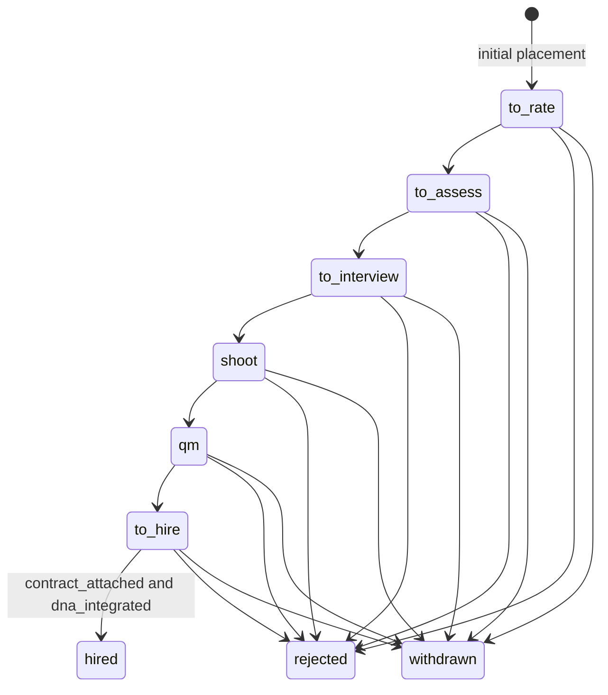

# Aria Recruitment

Odoo 19 Community addon that rebuilds the Smart per-need pipeline on `hr_recruitment`.

This directory owns the shared stage spec at `spec/pipeline_stages.json`. Stage rows, the state machine, and the legal hire guard are generated from that file. Later Rust and Go layers load the same file.

## Pipeline



Terminal stages (`hired`, `rejected`, `withdrawn`) have no outgoing edge. One-step moves back along the pipeline are allowed until a terminal stage.

Hired is refused unless both are true:

1. A contract document is attached (`ir.attachment.aria_document_kind = contract`).
2. The DNA adapter returns `integrated` or `complete`.

The check runs in `create`, `write` (including sudo and RPC), import (`load`), and stage recomputation. Reordering stages does not open Hired. Every attempt, allowed or refused, writes `aria.recruitment.transition.audit` and a chatter note. Audit rows are append-only.

DNA is Mantu's ERP. The built-in adapter is fake: it reads `aria_dna_integration_status` and does not make a network call. Unknown adapter names fail closed. Register another in-process adapter only when a real integration exists. Do not put credentials in this module.

## Also in this module

- Job offer fields and need filters (languages, job fields, experience level, location, client company, contract type; Consulting/Staff, Business/Corporate, Active/Strategic, Anticipated/Waiting/Running/Closed, P1–P4).
- My Weekly List for ITW1, ITW2, and ITW3-signature on To Interview, Shoot, and QM, with grade, stars, proposal status, a 7-day stale filter, and a list view that exports.
- Incomplete ITW: marking an interview done without a report schedules an overdue "Interview report" activity.

Cross-keys: `aria_smart_need_id`, `aria_smart_candidate_id`, and `aria_utm_link`.

## Tests

Synthetic data only (`*.example.test`). From the repository root, with Docker:

```bash
bash odoo_addons/aria_recruitment/ci/run.sh
```

That starts `odoo:19` (Community) and `postgres:16` and runs this addon's Odoo tests. The database password in `ci/docker-compose.yml` is the image default for that disposable database.
